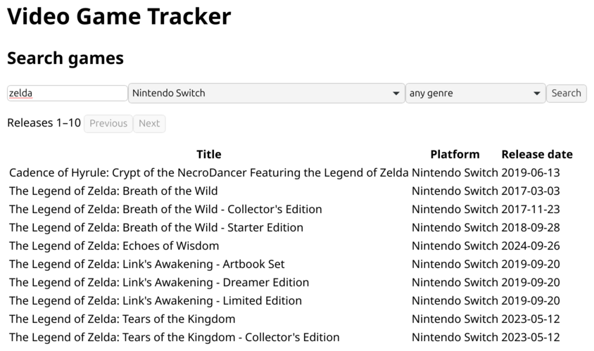
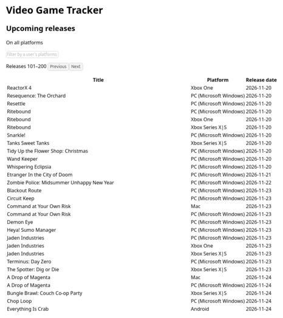
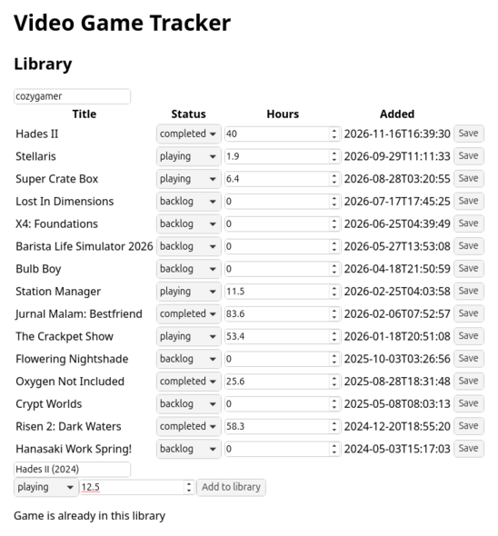
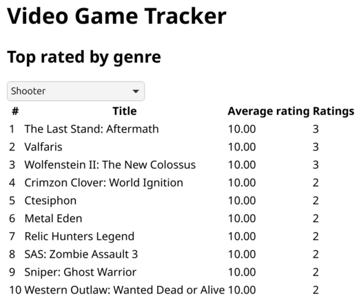

# Feature tests on the production database

Features 1-4 were run in the app against the production database (`sql/load_production.sql`, 117,660 games, 25,000 users) on 2026-11-16. Screenshots are in `docs/screenshots/`. Feature 2 compares release dates with `CURDATE()`, so its rows change with the date the app is run.

To repeat these tests, load the production database, start the backend and frontend (see the README), and open `http://localhost:5173`.

## Feature 1: Search games by title, platform, and genre

Steps:

1. Open the page. The search lists the first 100 releases of all games, sorted by title, with Previous disabled and Next enabled.
2. Type `zelda` in the title box, choose `Nintendo Switch` as the platform, leave the genre as "any genre", and press Search.

Expected: "Releases 1–10" and 10 Switch releases whose titles contain "Zelda", sorted by title, from "Cadence of Hyrule: Crypt of the NecroDancer Featuring the Legend of Zelda" to "The Legend of Zelda: Tears of the Kingdom - Collector's Edition". Previous and Next are both disabled.



## Feature 2: Upcoming releases

Steps:

1. Open the page. With no user chosen, the Upcoming section shows "On all platforms" and the first 100 upcoming releases, earliest first. Undated releases (TBA) come after every dated one.
2. Press Next, then Previous.
3. Type `couchcoop` in the user box and choose `couchcoop`.

Expected:

- Step 1: releases start at the day after today (2026-11-17 on the test date).
- Step 2: Next shows "Releases 101–200", and Previous goes back to "Releases 1–100".
- Step 3: the heading changes to "On couchcoop's platforms, not in their library", the page resets to "Releases 1–100", and only couchcoop's 3 platforms appear (Nintendo Switch, PlayStation 4, Xbox One).
- Clearing the user box goes back to all platforms.




## Feature 3: View a library, add a game, and update status/hours

Steps:

1. In the Library section, type `cozygamer` and choose `cozygamer`. Their 14 library entries load, newest first.
2. In the game box, type `Hades II` and choose "Hades II (2024)". Set the status to `playing`, enter `12.5` hours, and press "Add to library".
3. In the new Hades II row, change the status to `completed` and the hours to `40`, then press Save.
4. Choose "Hades II (2024)" in the game box again and press "Add to library".

Expected:

- Step 2: Hades II appears at the top of the library with `playing` and 12.5 hours. The library has 15 entries.
- Step 3: the row shows `completed` and 40 after reloading. The database row is `(7, 228525, 'completed', 40.0)`.
- Step 4: the message "Game is already in this library" appears and nothing is added.

After the test, the entry was removed so the production data matches `data/production/`:

```sql
DELETE FROM library_entry WHERE user_id = 7 AND game_id = 228525;
```




## Feature 4: Top-rated games in a genre

Steps:

1. In the "Top rated by genre" section, choose `Shooter`.

Expected: 10 games, ranked by average rating, then number of ratings, then title. All 10 average 10.00. The first three ("The Last Stand: Aftermath", "Valfaris", "Wolfenstein II: The New Colossus") have 3 ratings each, and the other seven have 2.



## Problems found on production data and their fixes

Response sizes and times are from `curl` against the local backend.

| # | Problem | Fix |
|---|---|---|
| P1 | `GET /api/upcoming` with no user returned all 22,007 upcoming releases (1.7 MB) in one response. | 100 rows per page with Previous and Next, as in Feature 1. The first page is 10.7 KB in 0.14 s. |
| P2 | In that list, the 17,955 undated releases sorted first because MySQL sorts `NULL` before dates. The first 180 pages would have been TBA. | Order by `gp.release_date IS NULL` first, so undated releases come last. |
| P3 | `GET /api/upcoming?user_id=N` returned all of a user's upcoming releases (2,590 rows for user 1). | Paged the same way. |
| P4 | Upcoming rows were keyed by title and platform. 34 title and platform pairs among upcoming releases belong to more than one game (69 rows, one pair shared by 3 games), which gives duplicate React keys. | `g.game_id` is now returned and used in the key, and added to `ORDER BY` so the order is total across pages. |
| P5 | `GET /api/users` returned all 25,000 users (1.1 MB), and the Upcoming and Library sections each rendered them as a 25,000-option dropdown. | Replaced both dropdowns with a type-to-search user picker. `GET /api/users?q=` returns up to 10 usernames starting with `q`, which can use the `UNIQUE` index on `username` (0.04 s). |

Not changed, but seen on production data:

- An empty search (Feature 1) takes about 0.9 s, because it sorts all 234,882 releases by title to return the first 100. This is left for the production performance work (#4).
- Feature 4's top 10 in every genre tested is games with a 10.00 average from 2-3 synthetic reviews. The query does what the report says. A minimum number of ratings would make the ranking more useful, but that changes the feature's definition.
